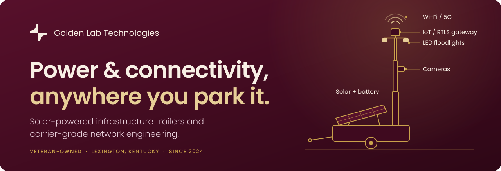

  

  <a href="https://www.goldenlabtech.com"><b>goldenlabtech.com</b></a>
  &nbsp;&middot;&nbsp;
  <a href="https://www.goldenlabtech.com/solar-trailers">Solar trailers</a>
  &nbsp;&middot;&nbsp;
  <a href="https://www.goldenlabtech.com/services">Services</a>
  &nbsp;&middot;&nbsp;
  <a href="https://www.goldenlabtech.com/plan-your-site">Plan your site</a>
  &nbsp;&middot;&nbsp;
  <a href="https://www.goldenlabtech.com/contact">Contact</a>

 

Golden Lab Technologies deploys and operates **solar-powered infrastructure trailers**. Each one is a towable platform whose telescoping mast carries Wi-Fi/5G, cameras, LED floodlights and IoT/RTLS gateway hosting, so a network can stand up where there is no grid power and no network. It is offered as a flat-rate monthly rental with no fuel cost.

Behind the trailers is a practice with 20+ years of carrier-grade network engineering. The founders spent decades building wireless networks at Alvarion, PureWave and Radisys. Golden Lab is veteran-owned and was founded in 2024 in Lexington, Kentucky, by United States Marine Corps veteran Jason Hawley.

## What we do

| Service | What it covers |
| :-- | :-- |
| **[Solar-powered trailers](https://www.goldenlabtech.com/solar-trailers)** | Off-grid power, connectivity, lighting and surveillance on a towable platform. Our flagship. |
| **[Managed network services](https://www.goldenlabtech.com/managed-network-services)** | Concierge-level monitoring and management of enterprise networks across North America. |
| **[Engineering and infrastructure](https://www.goldenlabtech.com/engineering-infrastructure)** | RF surveys, wireless design, private 5G and LTE, assessments and turn-key builds. |
| **[IT consulting](https://www.goldenlabtech.com/it-consulting)** | Senior operators advising on network, mobility and IoT strategy. |
| **[Staffing](https://www.goldenlabtech.com/staffing)** | Vetted wireless and network engineers on your site, without big-firm overhead. |
| **[Product procurement](https://www.goldenlabtech.com/product-procurement)** | Sourcing and logistics for enterprise network hardware, matched to the environment being built. |

## Where the trailers work

- **[Vehicle lots](https://www.goldenlabtech.com/vehicle-lots):** RTLS gateways, light and cameras for yards, terminals, auction and dealer lots.
- **[Construction sites](https://www.goldenlabtech.com/construction-sites):** lighting, cameras and Wi-Fi for job sites before permanent power arrives.
- **[Events and festivals](https://www.goldenlabtech.com/events):** temporary Wi-Fi, lighting and cameras for outdoor venues and parking.
- **[Emergency response](https://www.goldenlabtech.com/emergency-response):** off-grid connectivity and light for response operations, deployed through our partner, the Information Technology Disaster Resource Center (ITDRC).

## In the field

**Holman**, the national fleet services company, uses Golden Lab trailers for asset tracking on unpowered lots in O'Fallon, Missouri. Holman reports a 60 percent cost reduction compared with diesel light towers. [Read the case study &rarr;](https://www.goldenlabtech.com/case-studies)

## About this organization

This organization holds Golden Lab Technologies' software projects. For anything else, from a site quote to a partnership, [contact us](https://www.goldenlabtech.com/contact) or write to [inquiries@goldenlabtech.com](mailto:inquiries@goldenlabtech.com).

 

  <b>Golden Lab Technologies</b> &nbsp;&middot;&nbsp; Powering Innovation For Tomorrow.

